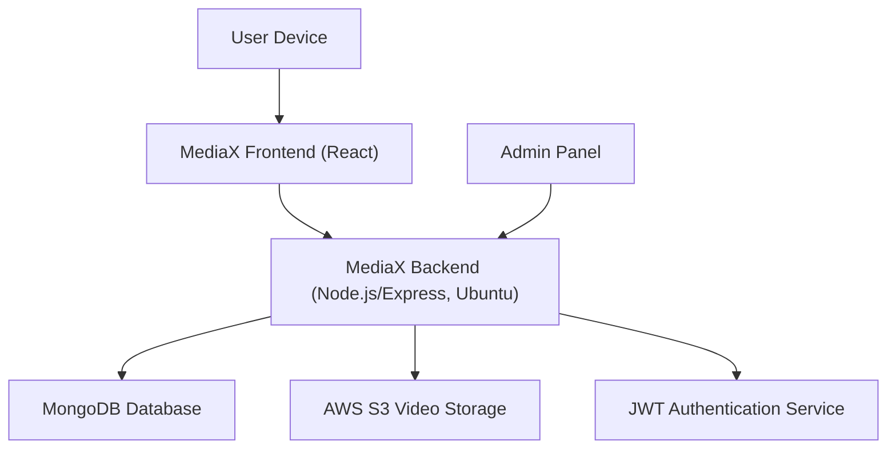
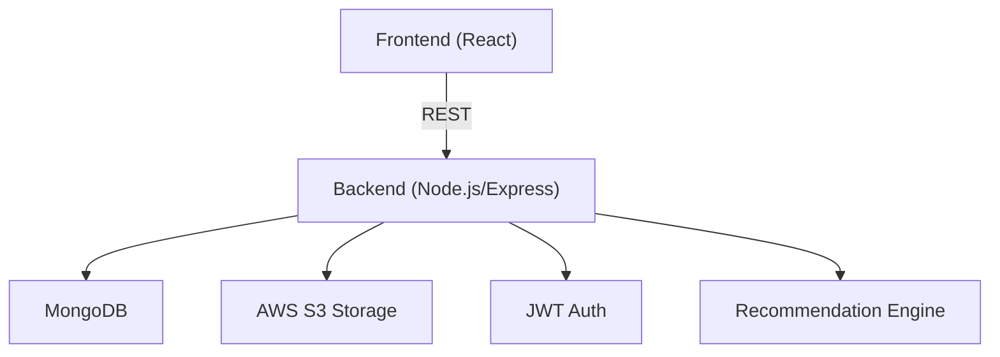
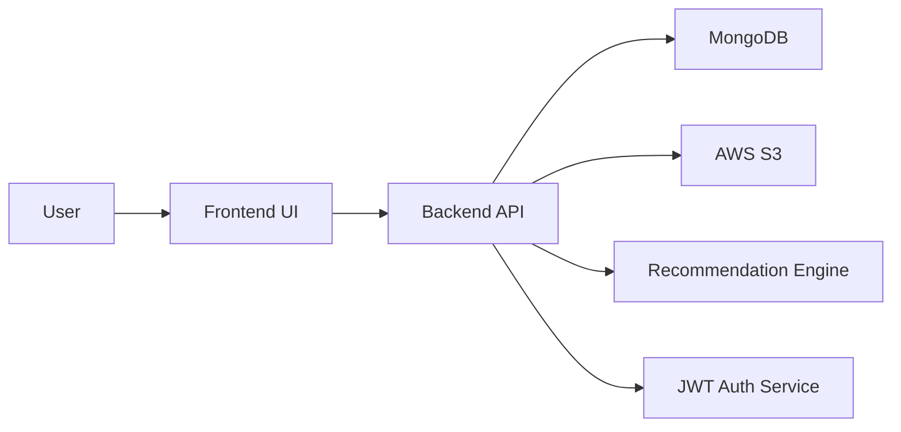

# MediaX

MediaX is a modern web application for streaming movies and TV shows, featuring an elegant, responsive user interface and a robust backend. It provides seamless user experiences for media discovery, playback, account management, and personalized recommendations.

---

## System Requirements Specification (SRS)

### 1. Introduction

#### 1.1 Purpose

MediaX is designed to provide users with a comprehensive platform for exploring, viewing, and managing media content. The application supports user authentication, media streaming, search, recommendations, and user profiles.

#### 1.2 Scope

- Web-based platform for media streaming
- User registration, authentication, and profile management
- Media catalog with detailed metadata, search, and filter
- Secure video streaming and adaptive playback
- Personalized recommendations and watch history

---

### 2. Overall Description

#### 2.1 Product Perspective

MediaX is a client-server application with a React-based frontend and a Node.js/Express backend. Media assets and metadata are stored in a MongoDB database and served via RESTful APIs. Video storage is handled via AWS S3.

#### 2.2 User Classes and Characteristics

- **Guest:** Can browse catalog, limited actions
- **Registered User:** Can stream content, maintain profile, view recommendations
- **Admin:** Manage media catalog, users, and system configurations

#### 2.3 Operating Environment

- **Frontend:** Chrome, Firefox, Safari, Edge
- **Backend:** Node.js server on Linux Ubuntu
- **Database:** MongoDB
- **Video Storage:** AWS S3

---

### 3. Functional Requirements

#### 3.1 User Authentication

- Register/Login/Logout with JWT-based security
- Password reset and email verification

#### 3.2 Media Catalog

- Browse, search, and filter media by genre, year, rating
- Media detail pages with metadata, trailers, and cast info

#### 3.3 Streaming

- Secure, adaptive video streaming (HLS/DASH)
- Play, pause, seek, and track playback progress

#### 3.4 Recommendations

- Personalized suggestions based on watch history and ratings
- "Continue Watching" and "My List" features

#### 3.5 Admin Panel

- CRUD operations for media items
- User management, analytics dashboard

#### 3.6 Additional Features

- Responsive design for all devices
- Accessibility compliance (WCAG 2.1)
- API documentation (Swagger/OpenAPI)
- Activity logging and audit trails
- Error handling and monitoring

---

### 4. Non-Functional Requirements

#### 4.1 Performance

- Fast page loads, minimal buffering
- Scalable architecture for high traffic

#### 4.2 Security

- HTTPS, JWT, CSRF protection
- Data encryption in transit and at rest

#### 4.3 Reliability

- Fault-tolerant backend, error logging, and recovery

#### 4.4 Usability

- Responsive design, accessible UI (WCAG 2.1)
- Intuitive navigation and media controls

#### 4.5 Maintainability

- Modular codebase with clear separation of concerns
- Well-documented APIs and components

#### 4.6 Scalability

- Horizontal scaling for backend servers
- AWS S3 for virtually unlimited storage

---

### 5. Architectural Diagrams

#### 5.2 Mermaid High-Level Architecture (for markdown rendering)



#### 5.3 Component Diagram



#### 5.4 Data Flow Diagram (DFD)



---

### 6. Database Schema Overview (MongoDB)

- **Users:**  
  ```json
  {
      _id,
      name,
      email,
      password_hash,
      profile_image,
      watchlist: [mediaId],
      history: [mediaId],
      roles
  }
  ```
- **Media:**  
  ```json
  {
      _id,
      title,
      description,
      genre,
      release_date,
      cast: [{name, role}],
      rating,
      cover_image,
      video_s3_url
  }
  ```
- **Recommendations:**  
  ```json
  {
      _id,
      user_id,
      media_id,
      score
  }
  ```
- **Admins:**  
  ```json
  {
      _id,
      name,
      email,
      role
  }
  ```

---

### 7. API Endpoints (Sample)

- `POST /api/auth/register` – Register user
- `POST /api/auth/login` – Authenticate user, returns JWT
- `GET /api/media` – List all media
- `GET /api/media/:id` – Get media details
- `POST /api/user/watchlist` – Add to watchlist
- `GET /api/user/history` – Get watch history
- `POST /api/admin/media` – Add new media item

#### API Documentation

Full interactive API docs are available via Swagger at `/api/docs` after starting the backend server.

---

### 8. Technologies Used

- **Frontend:** React, Redux, HTML5, CSS3, JavaScript
- **Backend:** Node.js, Express, JWT
- **Database:** MongoDB
- **Media Streaming:** HLS/DASH, Nginx (optional)
- **Authentication:** JWT, bcrypt
- **Cloud/Storage:** AWS S3
- **DevOps:** PM2, Docker, GitHub Actions, Ubuntu Server

---

### 9. Setup & Installation

1. Clone the repository:
    ```sh
    git clone https://github.com/naveenfullstack/MediaX.git
    ```
2. Install dependencies:
    ```sh
    npm install
    ```
3. Configure environment variables (see `.env.example`)
    - Set MongoDB URI, AWS S3 keys, JWT secret, etc.
4. Start the backend:
    ```sh
    npm run server
    ```
5. Start the frontend:
    ```sh
    npm start
    ```

---

### 10. Contribution

Contributions are welcome! Please open issues and submit pull requests for improvements and new features.


---

## Contact

For questions or support, contact [naveenfullstack](https://github.com/naveenfullstack).
